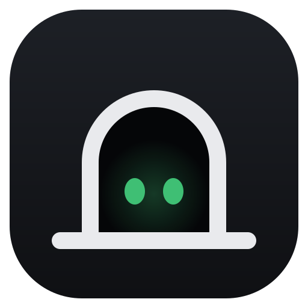
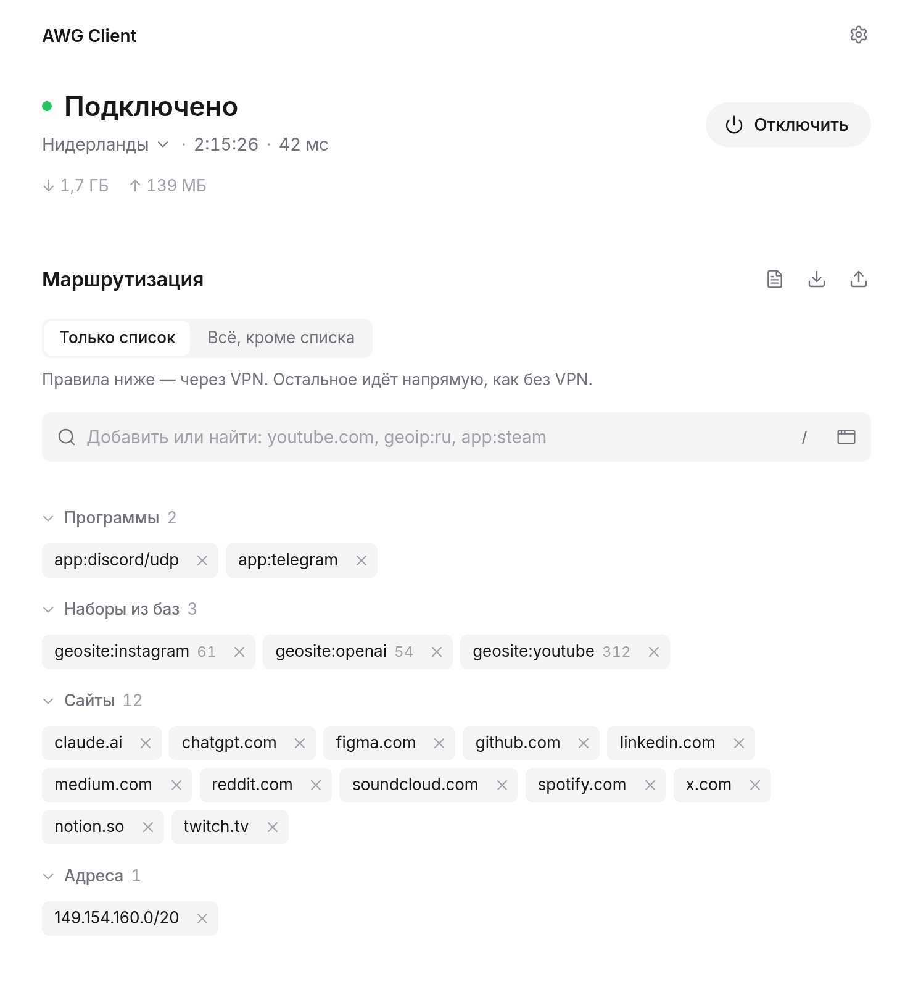
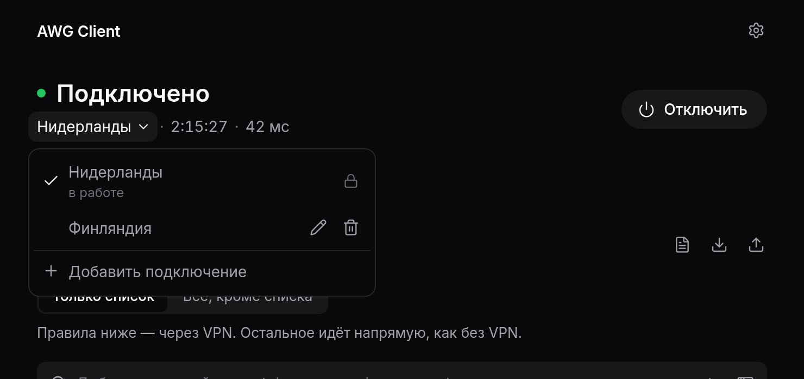
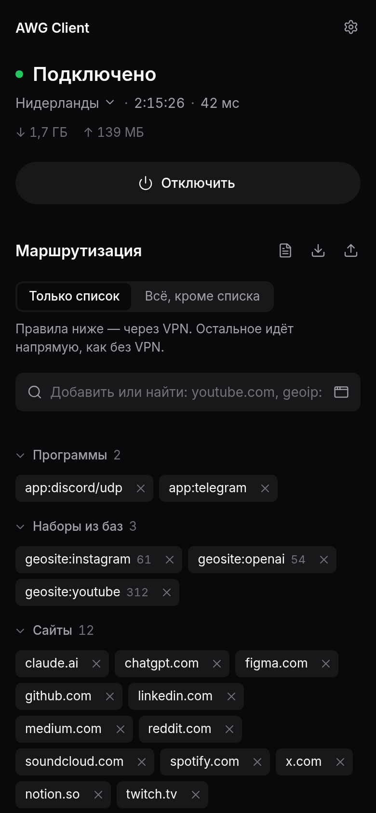
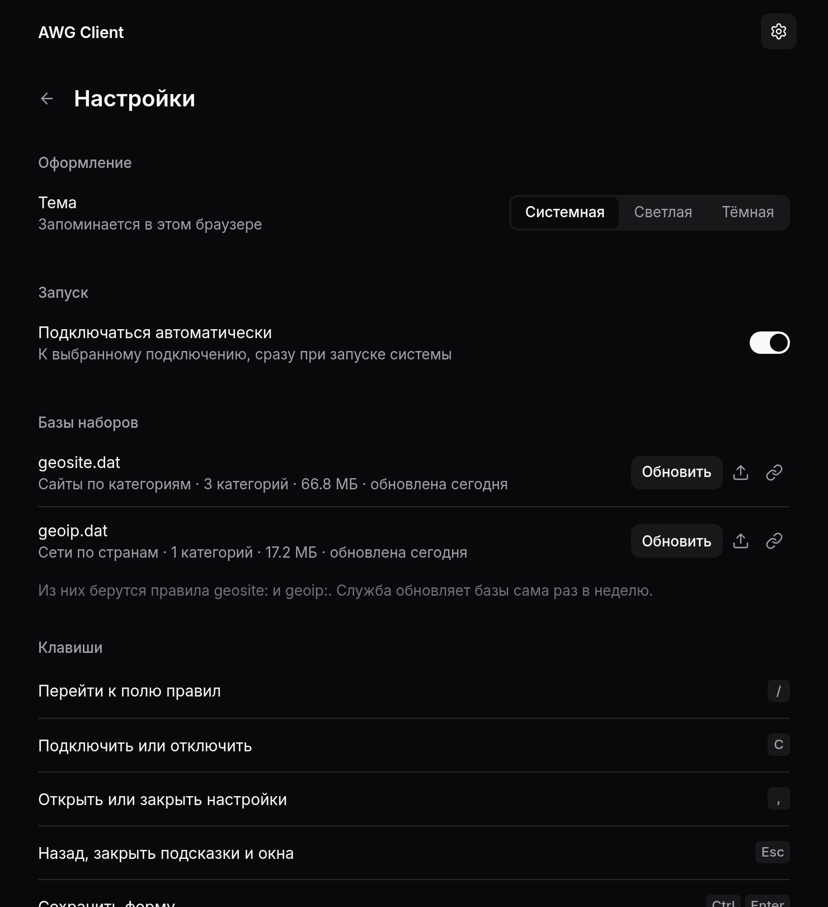

<p align="center">
  
</p>

<h1 align="center">AWG Client</h1>

<p align="center">
  Клиент <a href="https://docs.amnezia.org/">AmneziaWG</a> для <b>Linux</b> и <b>Windows</b>.<br>
  Служба держит туннель, интерфейс открывается в браузере — <a href="http://127.0.0.1:7070">127.0.0.1:7070</a>.
</p>

<p align="center">
  <picture>
    <source media="(prefers-color-scheme: dark)" srcset="docs/screenshots/main-dark.png">
    
  </picture>
</p>

- **Подключения** из файлов `.conf` AmneziaWG и WireGuard, включая
  AmneziaWG 1.5 и 2.0 (`I1`–`I5`, диапазоны `H1`–`H4`). Ядро `amneziawg-go`
  встроено — ставить отдельно ничего не нужно.
- **Маршрутизация**: через VPN идёт только список — или всё, кроме списка.
- **Правила** по домену, IP, подсети, наборам `geosite:`/`geoip:` и
  программам — на обеих системах.
- **Надёжность**: автоподключение при старте, переподключение при обрыве,
  обнаружение мёртвого туннеля.
- **Интерфейс**: минималистичный, светлая и тёмная тема, работает и с
  телефона по ширине экрана, управляется с клавиатуры.

**Содержание:** [Установка](#установка) · [Первый запуск](#первый-запуск) ·
[Правила](#правила-маршрутизации) · [Управление службой](#управление-службой) ·
[Обновление](#обновление) · [Удаление](#удаление) ·
[Неполадки](#если-что-то-не-работает) · [Сборка](#сборка-из-исходников)

---

## Установка

Архивы — на [странице релизов][releases], под x86_64.

### Linux

Нужны systemd и iproute2 (есть почти везде).

```sh
# скачать последнюю версию
v=$(curl -fsSL https://api.github.com/repos/Zahar-Seliverstov/amneziawg-client/releases/latest \
    | sed -n 's/.*"tag_name": *"v\([^"]*\)".*/\1/p')
curl -fLO "https://github.com/Zahar-Seliverstov/amneziawg-client/releases/download/v$v/awg-client_${v}_linux_amd64.tar.gz"

# распаковать и установить
tar xzf "awg-client_${v}_linux_amd64.tar.gz"
sudo awg-client/install.sh
```

Программа ставится в `/usr/local/lib/awg-client`, в меню приложений
появляется «AWG Client».

### Windows 10/11

В **PowerShell** (обычном, не от администратора):

```powershell
# скачать последнюю версию
$v = (Invoke-RestMethod https://api.github.com/repos/Zahar-Seliverstov/amneziawg-client/releases/latest).tag_name.TrimStart('v')
Invoke-WebRequest "https://github.com/Zahar-Seliverstov/amneziawg-client/releases/download/v$v/awg-client_${v}_windows_amd64.zip" -OutFile awg-client.zip

# распаковать и установить (Windows спросит права администратора)
Expand-Archive awg-client.zip -DestinationPath awg-client -Force
Start-Process 'awg-client\AWG Client\install.cmd' -Verb RunAs
```

Или руками: скачать `awg-client_<версия>_windows_amd64.zip`, распаковать,
правой кнопкой по `install.cmd` → «Запуск от имени администратора».

Программа ставится в `C:\Program Files\AWG Client`, на рабочем столе
появляется ярлык «AWG Client».

### Проверка контрольных сумм

Скачайте `SHA256SUMS` из того же релиза.

```sh
# Linux
sha256sum -c SHA256SUMS --ignore-missing
```

```powershell
# Windows: сравнить со строкой из SHA256SUMS
(Get-FileHash awg-client.zip -Algorithm SHA256).Hash.ToLower()
```

---

## Первый запуск

1. Откройте <http://127.0.0.1:7070> (или ярлык «AWG Client»).
2. **+ Добавить подключение**: вставьте текст `.conf`, перетащите файл в
   окно или нажмите «Открыть файл…».
3. **Подключить** (или клавиша `C`).

Под состоянием — выбранное подключение, время в туннеле и пинг; нажатие на
имя подключения открывает список, где можно переключиться, изменить или
удалить подключение. Тема и автоподключение — в **настройках** (шестерёнка
справа вверху).

<table>
  <tr>
    <td width="50%"></td>
    <td width="50%" rowspan="2" align="center"></td>
  </tr>
  <tr>
    <td></td>
  </tr>
</table>

<sub>Скриншоты сделаны на демо-данных.</sub>

| Клавиша | Действие |
|---|---|
| `/` | перейти к полю правил |
| `C` | подключить или отключить |
| `,` | настройки |
| `Esc` | назад, закрыть подсказки |
| `Ctrl+Enter` | сохранить форму |

---

## Правила маршрутизации

Сначала выберите режим:

- **только список** — через VPN идут правила из списка, остальное напрямую;
- **всё, кроме списка** — через VPN идёт всё, правила из списка — напрямую.

Правило вписывается в одно поле, вид определяется по значению. Можно
вставить сразу список — по одному на строку или через пробел.

| Пример | Что охватывает |
|---|---|
| `example.com` | домен со всеми поддоменами |
| `.example` | вся зона: всё, что кончается на `.example` |
| `full:www.example.com` | ровно это имя, без поддоменов |
| `keyword:example` | все имена, где есть это слово |
| `regexp:^cdn[0-9]+\.` | имена по регулярному выражению |
| `203.0.113.10` | один адрес |
| `198.51.100.0/24` | подсеть |
| `geosite:youtube` | сайты категории из базы geosite.dat |
| `geoip:nl` | сети страны из базы geoip.dat |
| `app:firefox` | все соединения программы |
| `app:discord/udp` | только UDP программы: голос, видео |

Поле правил одновременно ищет по списку. Слово без точки (`youtube`) ищет
категорию в базах и подсказывает её. Значки справа от заголовка: правка
всего списка текстом, выгрузка и загрузка файлом JSON или списком строк.

Базы `geosite.dat` и `geoip.dat` служба скачивает и обновляет сама раз в
неделю; вручную — в **настройках**.

**Правила по именам** работают через посредника DNS службы: адрес сайта из
списка уводится в нужную сторону раньше, чем программа его получит. Поэтому
браузерный «безопасный DNS» (DoH) для них лучше выключить — его запросы
идут мимо посредника.

**Правила для программ** (`app:имя`) действуют и на всё, что программа
запускает: `app:steam` — это и игры из Steam. Программу выбирают кнопкой
справа в поле правил из списка запущенных или вписывают вручную — имя exe
без `.exe` на Windows, имя процесса на Linux. На Linux они работают через
cgroup и nftables, на Windows — через драйвер
[WinDivert](https://reqrypt.org/windivert.html), который идёт в архиве.

---

## Управление службой

Работают две службы: **`awg-service`** (туннель, маршруты, API на
`127.0.0.1:7071`) и **`awg-ui`** (интерфейс на `127.0.0.1:7070`). Обе
стартуют вместе с системой.

### Linux

```sh
systemctl status awg-service awg-ui        # состояние
sudo systemctl restart awg-service         # перезапуск (туннель переподключится)
journalctl -u awg-service -f               # журнал в реальном времени
journalctl -u awg-service --since -1h      # журнал за последний час
curl -s http://127.0.0.1:7071/api/vpn/status   # состояние туннеля из API
```

### Windows (PowerShell)

```powershell
Get-Service awg-service, awg-ui            # состояние
Restart-Service awg-service                # перезапуск (PowerShell от администратора)

# журнал службы туннеля (PowerShell от администратора)
Get-Content "$env:ProgramData\awg-client\logs\awg-service.log" -Tail 50 -Wait

# состояние туннеля из API
Invoke-RestMethod http://127.0.0.1:7070/api/vpn/status
```

Где что лежит:

| | Linux | Windows |
|---|---|---|
| Программа | `/usr/local/lib/awg-client` | `C:\Program Files\AWG Client` |
| Подключения и правила | `/var/lib/awg-client` | `%ProgramData%\awg-client` |
| Журналы | `journalctl -u awg-service` | `%ProgramData%\awg-client\logs` |

Папки с данными доступны только администраторам: в `.conf` лежат ключи.

---

## Обновление

Скачайте новый архив и установите поверх — команды те же, что при
[установке](#установка). Подключения и правила сохраняются.

---

## Удаление

```sh
# Linux
sudo /usr/local/lib/awg-client/install.sh --uninstall
```

```powershell
# Windows (PowerShell)
Start-Process "$env:ProgramFiles\AWG Client\uninstall.cmd" -Verb RunAs
```

Подключения и правила остаются в `/var/lib/awg-client` или
`%ProgramData%\awg-client` — удалите папку вручную, если они не нужны.

---

## Если что-то не работает

**Интерфейс пишет «Нет связи со службой».** Служба `awg-service` не
запущена — посмотрите её состояние и журнал (см.
[Управление службой](#управление-службой)).

**«Подключено», но сайты не открываются.**

- Не включён ли второй VPN-клиент. Его блокировка трафика (kill switch)
  режет чужие туннели, а два туннеля на один сервер мешают друг другу.
  Оставьте включённым один.
- Режим «только список»: через VPN идёт только список, остальное — напрямую.
  Сайт, недоступный без VPN, нужно добавить в список (например,
  `geosite:youtube`) или переключиться на «всё, кроме списка».
- Сайт из списка открывается не тем путём — в браузере включён «безопасный
  DNS» (DoH): выключите его в настройках браузера.

**Правила для программ не действуют на Windows.** Антивирус мог удалить
`WinDivert64.sys` из `C:\Program Files\AWG Client` — добавьте папку в
исключения и переустановите. В журнале службы будет строка «Правила для
программ недоступны».

**Пинг показывает «—».** Сервер не отвечает ни на ICMP, ни на TCP — на
работу туннеля это не влияет.

**Порт 7070 или 7071 занят.** Проверьте, кто его держит:

```sh
ss -ltnp | grep -E ':707[01]'                       # Linux
```

```powershell
Get-NetTCPConnection -LocalPort 7070,7071 -State Listen   # Windows
```

---

## Сборка из исходников

Нужны Go 1.25+, Node.js 22+, `make`, `curl`, `python3`.

```sh
git clone https://github.com/Zahar-Seliverstov/amneziawg-client.git
cd amneziawg-client

./install.sh      # Linux: собрать и установить
make dist         # архивы для Linux и Windows в dist/
make test         # go vet под обе ОС, тесты Go и интерфейса
```

Windows-архив собирается на Linux кросс-компиляцией; `wintun.dll` и
WinDivert скачиваются при сборке со сверкой контрольных сумм.

### Разработка

```sh
make dev-service   # служба (через sudo) с отдельным состоянием в backend/build/dev
make dev-frontend  # интерфейс с горячей перезагрузкой на :5173, /api — в службу
make dev-ui        # собранный интерфейс через awg-ui на :7070
```

### Как устроено

- **`backend/cmd/awg-service`** — ядро, маршруты, DNS, состояние и HTTP-API.
  Права администратора: root под systemd, LocalSystem в Windows.
- **`backend/cmd/awg-ui`** — без прав (DynamicUser / LocalService): раздаёт
  интерфейс и пересылает `/api` службе, поэтому CORS не нужен.
- **`frontend/src`** — Vue 3 + Vite: `api/` (клиент и типы), `lib/` (чистые
  функции с тестами), `stores/` (общее состояние), `composables/`,
  `components/`. Шрифт Inter, иконки [Lucide](https://lucide.dev).

Протоколы подключаются модулями. Граница — пакет `internal/tunnel`:

| Пакет | Что делает |
|---|---|
| `internal/tunnel` | контракт: `Protocol` (разбор текста), `Engine` (запуск интерфейса), `Device`, сводка `Spec` и реестр |
| `internal/protocol/amneziawg` | формат `.conf` AmneziaWG/WireGuard: разбор и проверка |
| `internal/engine/awggo` | ядро amneziawg-go внутри процесса службы |
| `internal/profiles` | сохранённые конфигурации ↔ протоколы: распознаёт формат, готовит цель подключения |
| `internal/vpn` | соединение без знания протокола: рукопожатие, переподключение, маршруты, DNS, правила |
| `internal/config` | хранилище: конфигурации исходным текстом, правила, настройки |
| `internal/appsteer` | правила для программ на Windows: перехват WinDivert и перевод соединений на адрес нужного интерфейса |

Новый протокол или другое ядро — это пакет, реализующий `tunnel.Protocol`
и/или `tunnel.Engine`, и одна строка в реестре в
`backend/cmd/awg-service/main.go`. Менеджер соединения, API, хранилище и
интерфейс при этом не меняются: интерфейс получает список протоколов от
службы (`GET /api/protocols`).

Платформенные части разделены файлами `_unix.go` / `_windows.go`:

| Что | Linux | Windows |
|---|---|---|
| TUN | `/dev/net/tun` | wintun |
| Адреса и маршруты (`internal/iproute`) | команда `ip` | IP Helper API |
| Серверы имён (`internal/vpn/dns_*`) | resolvconf или `/etc/resolv.conf` | DNS туннеля + правило NRPT |
| Правила для программ | cgroup, nftables, своя таблица | WinDivert (`internal/appsteer`) |
| Запуск службой (`internal/service`) | юнит systemd | служба Windows |

Оба порта слушают только петлевой адрес; от чужих страниц в браузере API
закрыт проверкой `Host` и `Origin` (`internal/localguard`).

### Выпуск релиза

Версия — в файле `VERSION`, она должна совпадать с тегом.

```sh
# поднять VERSION, описать изменения в CHANGELOG.md, закоммитить
git tag -a v2.2.0 -m "AWG Client 2.2.0"
git push origin main v2.2.0
```

[Workflow](.github/workflows/release.yml) соберёт архивы для Linux и
Windows, посчитает контрольные суммы и опубликует релиз с заметками из
`CHANGELOG.md`.

[releases]: https://github.com/Zahar-Seliverstov/amneziawg-client/releases/latest
